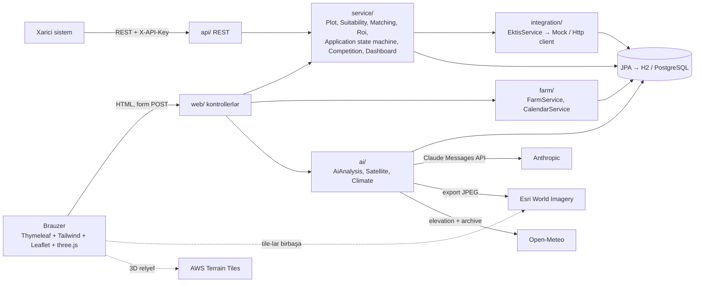

# AgroInvest Qarabağ

Qarabağ və Şərqi Zəngəzurda kənd təsərrüfatına investisiya portalı (hakaton MVP). İnvestor torpaq sahələrini tapır
(xəritə, kataloq, meyvə uyğunluğu, uyğunluq testi), qiymətləndirir (pasport, ROI + proqnoz, peyk + 3D + AI analizi),
müsabiqəyə müraciət edir və statusu izləyir. Operator baxır, komissiya qərar verir, qərar EKTİS-ə (mock) gedir.
Təsdiqdən sonra investor təsərrüfatı idarə edir (əkin planı, əkin təqvimi, işçi heyəti, rüblük hesabat), operator monitorinq aparır.

> Bütün məlumatlar uydurmadır. ROI, proqnoz və bitki parametrləri "Sınaq dəyəri", AI nəticələri "AI tövsiyəsidir" kimi işarələnib.

## İşə salma

Tələb: **JDK 21** (Maven wrapper layihədədir; Node, Docker lazım deyil).

```bash
./mvnw spring-boot:run      # http://localhost:8080
./mvnw test                 # 40 test, şəbəkəsiz
```

- Baza H2 in-memory-dir: **hər açılış = təmiz demo məlumatı** (restart demo-nu sıfırlayır).
- `spring-boot:run` `dev` profili ilə işləyir (DevTools): HTML/CSS/JS dəyişəndə brauzer özü yenilənir, Java kompilyasiyasında tətbiq yenidən başlayır.
- Swagger: http://localhost:8080/swagger-ui.html

### Mühit dəyişənləri

| Dəyişən | Susmaya görə | Nə üçün |
|---|---|---|
| `ANTHROPIC_API_KEY` | — | AI torpaq analizi. **Yalnız mühitdən** oxunur; fayla/git-ə yazmayın. Olmasa AI düyməsi deaktivdir, qalan hər şey işləyir. |
| `AI_MODEL` (`ai.model`) | `claude-haiku-5-5` | Demo üçün `claude-sonnet-5-5`. |
| `EKTIS_MODE` | `MOCK` | `HTTP` — real EKTİS adapteri (stub). |
| `EKTIS_MOCK_FAIL` | `false` | `true` — EKTİS göndərişləri uğursuz (retry demosu). Admin bunu `/idare/inteqrasiya`-da restartsız da dəyişə bilər. |
| `APP_EXTERNALAPIKEY` | `change-me` | `/api/v1/external/**` üçün `X-API-Key`. |

```bash
export ANTHROPIC_API_KEY=sk-ant-...      # Windows: setx ANTHROPIC_API_KEY "..."
export AI_MODEL=claude-sonnet-5-5
./mvnw spring-boot:run
```

## Demo hesablar (şifrə `Demo1234`)

| E-poçt | Rol | Nə görür |
|---|---|---|
| `elvin@demo.az` | İnvestor | Demo qəhrəmanı — müraciəti yoxdur, sıfırdan başlayır |
| `rashad@demo.az` | İnvestor | Təsdiqlənmiş müraciət + aktiv təsərrüfat (XCL-001) |
| `operator@demo.az` | Operator | Müraciətlərə baxış, müsabiqə yaratma, monitorinq |
| `komissiya@demo.az` | Komissiya | Müsabiqə təsdiqi, müraciət qərarı, audit |
| `admin@demo.az` | Admin | Hər şey + EKTİS retry, iqlim yeniləmə, AI yenidən analiz |

## Demo ssenarisi (qısa)

1. Elvin → **Uyğunluq testi** (Bağçılıq · 500 000 · 20–50 ha · Füzuli · 3–10) → FZL-001 birinci.
2. **Sahələr** → "Hansı meyvə üçün?" = Nar.
3. FZL-001 pasportu → mina, su, yol, meyvə faizləri, ROI + 3 ssenari + risklər; **3D**; müqayisə FZL-001 / FZL-002.
4. LCN-001 → **Peyk və AI analizi**.
5. FZL-001 → **Müraciət et** → `QAR-2026-000008`.
6. Operator → Baxışa başla → Əlavə məlumat istə. Elvin → 🔔 → cavab + PDF.
7. Komissiya → Müsbət qərar → EKTİS jurnalında SUCCESS, dashboard dəyişir.
8. Elvin → Təsərrüfatım → Fındıq 40 ha → əkin təqvimi, işçilər. Operator → Monitorinq.

**Demodan əvvəl:** tətbiqi yenidən başladın → admin: Dashboard → "İqlim məlumatını yenilə" → LCN-001 üçün AI analizini bir dəfə işə salın (keşə düşür).

## Deploy (Render)

Kök qovluqdakı `Dockerfile` iki mərhələlidir: Maven + JDK 21 ilə jar yığır, sonra `eclipse-temurin:21-jre` üzərində işə salır (root olmayan istifadəçi ilə). Lokal işə salmaq üçün Docker **lazım deyil** — bu yalnız deploy üçündür.

1. Render → **New → Web Service** → GitHub reposunu seçin → **Runtime: Docker** (Dockerfile avtomatik tapılır).
2. **Instance:** 512 MB kifayətdir — `JAVA_TOOL_OPTIONS="-XX:MaxRAMPercentage=75"` heap-i konteyner limitinin 75%-i ilə məhdudlaşdırır.
3. **Environment** (dəyərləri yalnız Render panelində yazın, fayla yox):

   | Dəyişən | Qeyd |
   |---|---|
   | `ANTHROPIC_API_KEY` | AI analizi üçün (olmasa AI düyməsi deaktivdir) |
   | `AI_MODEL` | demo üçün `claude-sonnet-5-5` |
   | `APP_EXTERNALAPIKEY` | `/api/v1/external/**` üçün güclü təsadüfi dəyər (`change-me` qalmasın) |

   `PORT`-u Render özü verir; tətbiq `server.port=${PORT:8080}` ilə onu oxuyur.
4. **Health check path:** `/`.

Qeydlər:
- Baza H2 in-memory-dir: hər restart və ya deploy = təmiz demo məlumatı. Pulsuz instans boş qalanda yatır, oyananda (~1 dəq) demo sıfırlanır.
- `uploads/` konteynerin içindədir və restartda silinir (demo üçün normaldır; daimi saxlama üçün Render Disk və ya obyekt anbarı lazımdır).

Lokal yoxlama:

```bash
docker build -t agroinvest .
docker run -p 8080:8080 -e ANTHROPIC_API_KEY=test agroinvest   # http://localhost:8080
```

## Səhifələr

| URL | Kim | Nə |
|---|---|---|
| `/`, `/xerite`, `/saheler`, `/saheler/{id}`, `/muqayise`, `/musabiqeler`, `/uygunluq` | hamı | ana səhifə, xəritə (Xəritə/Peyk), kataloq, pasport (+3D, AI), müqayisə, müsabiqələr, test |
| `/giris`, `/qeydiyyat` | anonim | giriş, investor qeydiyyatı |
| `/kabinet`, `/kabinet/muraciet/…`, `/kabinet/teserrufat/{id}` | investor | profil, müraciətlər, təsərrüfat |
| `/bildirisler` | daxil olmuş | bildirişlər |
| `/idare`, `/idare/muracietler`, `/idare/musabiqeler`, `/idare/monitorinq`, `/idare/inteqrasiya` | işçilər | dashboard, müraciətlər, müsabiqələr, monitorinq, EKTİS jurnalı |
| `/idare/audit` | komissiya, admin | audit jurnalı |
| `/api/v1/…` | REST | sahələr, müsabiqələr, müraciət statusu, xarici qərarlar (`X-API-Key`) |

## Arxitektura



Bir Spring Boot tətbiqi (Java 21) həm backend-i, həm də server-side HTML-i verir. Müraciət statusu **yalnız** `ApplicationService`-də dəyişir; hər dəyişiklik → StatusHistory + AuditLog + Notification.

## PostgreSQL və real EKTİS

- **PostgreSQL:** `./mvnw spring-boot:run -Dspring-boot.run.profiles=pg` və `DB_URL`, `DB_USER`, `DB_PASSWORD` (`application-pg.properties`). Hazırda `ddl-auto=create` — hər açılışda sxem yenidən yaranır və seed yazılır (demo davranışı). İstehsal üçün Flyway/Liquibase və `ddl-auto=validate` lazımdır.
- **Real EKTİS:** `EKTIS_MODE=HTTP` → `HttpEktisClient` aktivləşir; `send()` daxilində Nazirliyin API müqaviləsinə uyğun POST yazılmalıdır (payload `EktisService.payload`, schemaVersion 1.0).

## Təhlükəsizlik

Form login + sessiya, BCrypt, CSRF. Başqasının müraciəti/təsərrüfatı/faylı → 404. İşçi siyahılarında və EKTİS JSON-unda FİN/VÖEN maskalanır (`5EL****`). Fayllar: yalnız PDF/JPG/PNG (uzantı + ilk baytlar), ≤ 5 MB. API açarı yalnız mühitdən, loglara yazılmır.

## Yol xəritəsi

Pay layihələri (şərik investisiya, Step 8 — seed-də nümunə təklif var) · real ödəniş və pay reyestri · NDVI ilə peykdən əkin monitorinqi · real EKTİS, ASAN Login / İmza · SMS, e-poçt, mobil tətbiq · Məşğulluq Agentliyi və bank inteqrasiyası · ekspert təsdiqi paneli (meyvə etiketləri) · məhsul satışı bazarı · PostgreSQL ilə istehsal.

## Claude Code ilə inkişaf

Qaydalar `CLAUDE.md`-də, spesifikasiya `docs/SPEC.md`-də, addımlar `steps/`-də, gediş `PROGRESS.md`-dədir. Əmrlər: `/step N`, `/fix <xəta>`, `/demo-check`.
